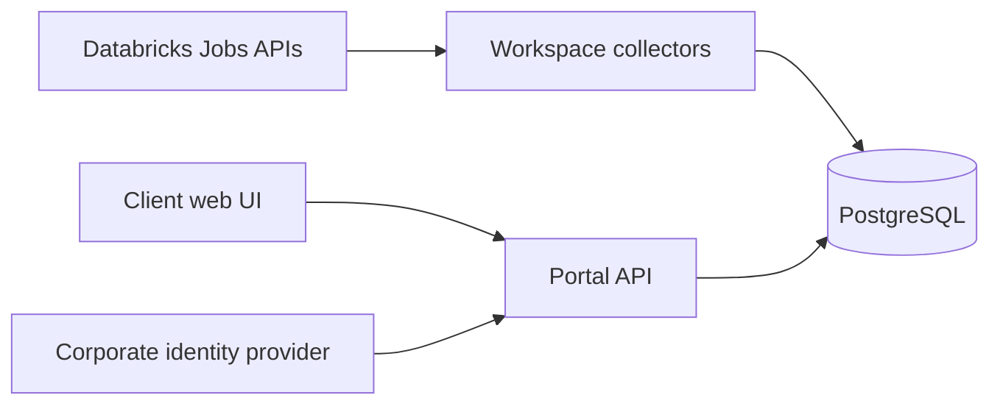

# Client-Specific Databricks Job Monitoring Portal

**Status:** Reviewed initial plan. A frontend prototype with sample data is now implemented; backend integration and production security controls remain planned. The initial requirements were reviewed from 24 screenshots; those source screenshots are not included in this repository.

## 1. Goal and scope

Build a secure, read-only portal for more than 100 internal client teams that use shared Databricks workspaces for `dev`, `stage`, and `prod`. Teams sign in with corporate SSO and use the portal to see assigned jobs, latest and active executions, the previous 30 days of available run history, task dependencies, and task-level failures. The portal shows when the data was last synchronized. Organizational policy keeps client viewers out of the Databricks workspaces.

The MVP includes all three workspace integrations, trusted ownership and access mappings, the jobs overview and run drill-down, automatic synchronization, manual refresh, approved task diagnostics, basic administrative configuration, and collector health monitoring. Job execution, restart, cancellation, editing, schedule and permission changes, and deletion are outside the portal’s scope. Full notebook rendering, cluster logs and management, cross-job or cross-platform lineage, data-quality validation, additional environments, client-managed ownership, advanced exports, and custom alerting are outside MVP scope.

## 2. Roles and ownership

| Role | Responsibilities and access |
| --- | --- |
| Client viewer | Browse, search, and filter assigned jobs, inspect runs and tasks, and request refresh of authorized data. |
| Platform administrator | Manage clients, user or SSO group grants, authorized applications and environments, and job ownership. Investigate synchronization and ownership failures through a restricted administrative interface or workflow. |

- Use a stable `client_id` as the tenant boundary. Use `apm_id` or an application ID for grouping or optional further restriction. Validate its meaning and uniqueness before relying on it in any mapping.
- Resolve access from a trusted user or group grant to a client and its authorized environments, then to approved jobs in the corresponding workspace. Key job ownership by `(workspace_id, job_id)`. The workspace configuration defines the environment. Job tags such as `client_id`, `apm_id`, and `environment` may suggest mappings for review.
- Only trusted administrators or approved automation can change ownership. Hide unmapped and conflicting jobs from viewers and flag conflicts for review. Keep shared jobs hidden until a separate isolation design is approved.
- Proposed default for transfers: revoke the old grant, invalidate affected cached responses, and withhold pre-transfer runs from the new owner pending historical access review. Record effective ownership periods for that review.

## 3. User experience

### Environment and navigation

- After login, offer only authorized environments. Open the sole authorized environment automatically, or reuse the last-used environment if it is still authorized. Keep the environment visible in the header and page title with a text label and distinct color.
- Include environment and resource identifiers in bookmarkable URLs, for example `/prod/jobs/123/runs/456/tasks/load_orders`. Validate the complete resource chain on the server. Switching environments returns to the jobs overview and clears environment-specific filters. Browser Back restores filters and scroll position.
- Reach task details within three clicks **from the jobs overview** via job → run → task. A failed run selects the first failed task by default and displays its permitted failure summary. A first-time environment selection can precede this path.

### Jobs, runs, and tasks

| View | Content and interactions |
| --- | --- |
| Jobs overview | Total authorized jobs, successful and failed runs in the selected period, and currently running executions. Show job name, application ID, latest status, latest start and duration, failure count, success rate, and last synchronization. Support search, status and application filters, date range, sorting, and pagination. |
| Job details | Identifiers, latest status, period metrics, current task graph, run history, freshness, and a 30-day timeline with one status-marked bar per run and bar height proportional to duration. |
| Run history | Run ID, start and end, duration, lifecycle and result states, trigger when available, and a failed task with a permitted one-line error summary. Filter by status and run start within the rolling window. |
| Run and task details | Selected-run graph and accessible task list. The side panel shows task key and type, status, timestamps, duration, attempt and repair history when available, and Error, Logs, and Output tabs where supported and permitted. |

- Render graph tasks as nodes and dependencies as directed edges. Include durations and status for the selected run, plus zoom, fit-to-screen, task selection, and a legend. Pair color with labels and icons. Use run-specific metadata or a verified definition version for historical graphs. If the graph cannot be reconstructed, show the task list and identify the missing graph data.
- Preserve source status values and normalize them for display, including pending, running, successful, failed, canceled, skipped, and unknown or unavailable. Define metric buckets before implementation. Proposed success-rate denominator is successful plus failed runs, with other outcomes shown separately and an empty denominator displayed as unavailable. Latest means the most recently started run in available data. Count currently running executions independently of the selected historical date range.
- Provide loading, empty, stale, partial, and error states. Show relative times and exact timestamps in a labeled timezone. Target WCAG 2.1 AA, keyboard navigation, light and dark themes, and laptop and tablet layouts. Validate the proposed sub-second p95 jobs-list and job-details load target against a representative workload.

## 4. Diagnostics and data protection

| Diagnostic | Candidate source and display |
| --- | --- |
| Failure category or reason | Run and task metadata, including termination details when present. Display an allowlisted plain-language summary. |
| Error and stack trace | `runs/get-output` for the applicable task-run ID on multitask jobs. Fetch for terminal failures when policy permits. |
| Standard output and error logs | `runs/get-output` for supported task types, subject to workspace permissions and available output. Collect for failures and fetch for successful tasks on demand only when enabled. |
| Notebook exit value | `notebook_output.result` where available and explicitly approved for display. |

Use a per-client, per-environment policy with levels `none`, `summary`, `error and stack trace`, and `logs`. Proposed default is an allowlisted summary, with traces, logs, and notebook output enabled only after approval and verification for that scope. Apply redaction before persisting, caching, auditing, or returning diagnostic text. Cover tokens, credentials, connection strings, and configurable patterns. Exclude unnecessary parameters, notebook paths, and infrastructure details using explicit response fields. Suppress free-form content where isolation or safe disclosure cannot be established.

Render diagnostic text safely as text. Show truncation when either the source or portal applies a cap, with 64 KiB per stored text field as a starting proposal. Provide a searchable monospace log viewer with line numbers and virtual scrolling as needed. If supporting ANSI color, interpret only approved styling codes. Audit access to error details and logs without recording the payload. Full rendered notebooks, cluster driver and executor logs, and log downloads are later-phase features. Validate support and limits per task type and workspace using sample runs. [Databricks run output and metadata reference](https://docs.databricks.com/api/jobs/v2/run) · [Lakeflow Jobs privileges](https://docs.databricks.com/aws/en/jobs/privileges)

## 5. Architecture and security

- Deploy one collector per Databricks workspace. The production portal serves all three monitored workspaces through workspace-scoped records. Non-production portal deployments use isolated storage and credentials and monitor only designated non-production workspaces.
- The portal API reads from PostgreSQL and enqueues authorized refresh and approved on-demand diagnostics requests for the relevant collector. Return stored data and refresh progress while the collector works. Deduplicate requests by workspace and resource, and recheck current viewer authorization before serving any result. Only collectors call Databricks and hold its credentials.
- Use individual corporate SSO accounts. Verify token signature, issuer, audience, and expiry when accepting tokens and validate the authenticated session on each request. Apply backend authorization to lists, totals, filters, deep links, jobs, graphs, runs, tasks, diagnostics, refreshes, and any future subscriptions or exports. Scope database queries and cache keys to the effective access and diagnostic policy. Consider PostgreSQL row-level security as defense in depth.
- Use a separate OAuth M2M monitoring service principal for each workspace, such as `sp-jobmonitor-dev`, `sp-jobmonitor-stage`, and `sp-jobmonitor-prod`. Use approved secret management and rotation. Grant job `CAN_VIEW` through workspace-specific reader membership only for jobs in the monitoring inventory. Apply grants in deployment templates and use an audited administrative backfill for existing eligible jobs. Detect missing grants against the expected inventory. Verify in `dev` that the principal can read required metadata and approved diagnostics and lacks execution and modification privileges. Treat unsupported diagnostics as unavailable while validating the minimum required permissions. [OAuth M2M authentication](https://docs.databricks.com/aws/en/dev-tools/auth/oauth-m2m) · [Lakeflow Jobs privileges](https://docs.databricks.com/aws/en/jobs/privileges)
- Audit ownership and access mapping changes, security configuration, significant authorization denials, collector authentication failures, and diagnostic views. Agree on and test a maximum revocation delay, including cached results and identity-provider group changes.

### Proposed stack

| Layer | Proposed technology |
| --- | --- |
| Web | React, TypeScript, shadcn/ui, Tailwind CSS, React Flow, TanStack Table |
| API and integration | Python, FastAPI, Databricks SDK for Python, one Databricks adapter module |
| Persistence | PostgreSQL with Alembic migrations |
| Identity and deployment | Existing corporate SSO and organization-approved VM, container platform, or Kubernetes |

Organize the backend around the adapter, ingestion, repositories, services, and API routes. Use `/api/v1` and generate TypeScript bindings from OpenAPI. Organize frontend features around jobs, runs, tasks, and logs, sharing components and documenting them in Storybook as needed. Use per-client and per-environment settings for staged rollout. Add linting, type checking, unit and authorization tests, Playwright coverage for the main journey, and structured logs, metrics, and OpenTelemetry traces.

## 6. Collection, history, and freshness

1. Discover job definitions, resolve trusted ownership, and backfill available runs started in the previous 30 days. Track active runs separately, including older runs. Persist approved job, run, and task fields and indicate incomplete backfill.
2. Discover new runs independently of browser traffic. Refresh active runs through completion, update definitions on a slower cadence, and periodically reconcile delayed data, repaired runs, and missing task metadata.
3. Follow list and detail pagination. Use Jobs API 2.2 job and run detail endpoints for complete task arrays when list responses are capped. Verify that the selected SDK version supports the required pagination and task output behavior. [Jobs API 2.2 pagination](https://docs.databricks.com/gcp/en/reference/jobs-api-2-2-updates) · [Jobs API job reference](https://docs.databricks.com/api/jobs/v2/job) · [Jobs API run reference](https://docs.databricks.com/api/jobs/v2/run)
4. Use workspace-scoped identifiers, idempotent upserts, and independent checkpoints per workspace and collection stream. Advance a checkpoint after its batch is durable. Use an overlapping discovery window, deduplicate repeated results, and protect newer state from delayed responses. Bound retries, apply backoff and jitter, and respect source rate limits.
5. Poll the portal API from active browser pages and pause when hidden. Apply authorization, deduplication, and rate limits to scoped manual and on-demand refresh. Consider Server-Sent Events and Databricks webhook ingestion later. Validate webhook events, setup, endpoint security, delivery behavior, and per-job configuration. Keep reconciliation enabled with webhooks.

| Information | Initial target to validate |
| --- | --- |
| New runs and completed results | Visible in roughly 60 seconds end to end |
| Active run and task status | Updated every 30–60 seconds |
| Job definition changes | Reflected in roughly 5–15 minutes |
| Historical reconciliation | Periodic background verification |

Measure end-to-end freshness with collector lag and browser polling included. Record last successful synchronization, in-progress state, stale warnings, and relevant failures by workspace and resource. Preserve authorized stored data during outages and indicate its age. An outage in one workspace affects only that workspace’s freshness indicators.

Persist workspace and environment configuration, clients, access grants, ownership records, jobs and definition versions, runs, task runs and attempts, approved diagnostics, synchronization checkpoints, and audit events. Store timestamps in UTC. Define separate retention periods for metadata, diagnostics, backups, and audit events according to policy. Allow a small metadata retention buffer where permitted, while keeping the displayed run history to the rolling 30-day start-time window. Index scoped queries, paginate large lists, and apply per-client and workspace quotas as needed. Size using job counts, daily runs, tasks per run, peak active runs, concurrent viewers, and source quotas.

## 7. Development phases

1. **Discovery and validation.** Confirm the identity provider, client groups, APM meaning, workload, grants, supported task types, history availability, and diagnostic output. Use a `dev` principal with sample jobs to validate read permissions and confirm write restrictions.
2. **Two-client prototype.** In `dev`, show mapped jobs, 30-day history, and a basic graph for two test clients. Verify cross-client isolation before broader onboarding.
3. **Secure MVP.** Integrate SSO, persistent collection, environment switching, refresh, ownership administration, freshness states, approved diagnostics, and authorization and retention tests.
4. **Production hardening.** Complete security review, operations dashboards and alerts, concurrency and quota testing, backup and restore drills, and onboarding and support documentation before production rollout.
5. **Optional enhancements.** Evaluate webhooks, Server-Sent Events, additional workflow types, rendered notebooks and cluster logs, log downloads, cross-environment comparison, and client-specific notifications.

## 8. Acceptance criteria

- Viewers see only authorized environments and mapped jobs. Attempts to access another tenant, another workspace, or mismatched job, run, or task IDs reveal no protected data through any endpoint, aggregate, filter, cache, diagnostic view, or refresh path. Access changes take effect within the agreed and tested interval.
- UI and API expose monitoring operations only. Collector permissions are read-only and credentials stay within the collector runtime. Tests verify separate principals and workspace scope.
- Successfully synchronized eligible jobs show their latest collected state. Available runs in the rolling window are displayed without pagination omissions or duplicates. Older active runs continue to be tracked. Timezone and date-window behavior are consistent.
- Supported dependency graphs and task statuses match source metadata. Missing or unsupported graphs and diagnostics are labeled accurately. A viewer can reach the permitted failure information within the defined navigation target.
- Diagnostic settings restrict collection and delivery, redaction is tested, truncated data is labeled, and sensitive text stays out of audit events and operational logs.
- New and active runs update within validated targets under representative load. Temporary API issues preserve history, mark affected data stale, and reconcile after recovery. Retries produce no duplicate runs.

## 9. Open decisions

| Decision | What to confirm |
| --- | --- |
| Identity and environment access | Corporate SSO provider, authoritative groups, refresh of group membership, and each client’s allowed environments, including whether `dev` is ever offered. |
| Ownership | Meaning and uniqueness of APM IDs, who controls discovery tags and trusted mappings, whether any jobs serve multiple teams, and historical access after transfers. |
| Workload and targets | Job, run, and task volumes, peak portal concurrency, required workflow types, source quotas, stale thresholds, and required end-to-end freshness. |
| Diagnostic policy and retention | Approved visibility levels per client and environment, output eligibility, supported APIs under `CAN_VIEW`, and retention periods. |
| Deployment and operations | Hosting, secret manager, workspace network connectivity, backup and recovery targets, and ownership of onboarding and operational support. |

The initial review proposes collector-mediated on-demand reads, summary-first diagnostics, and a historical access hold on ownership transfers. It also defines the three-click target from the jobs overview and calls for complete pagination and workspace-level validation of diagnostic permissions. These items are recorded here for approval or refinement during discovery.
